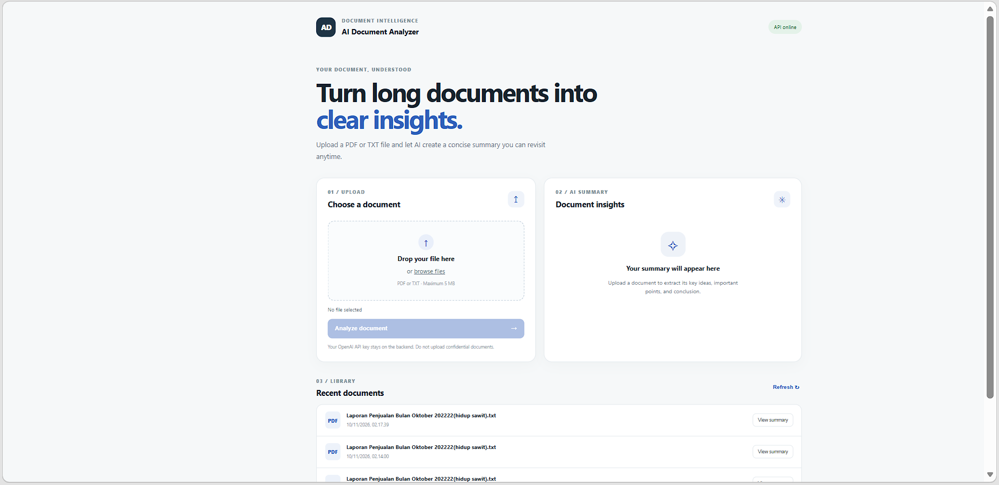
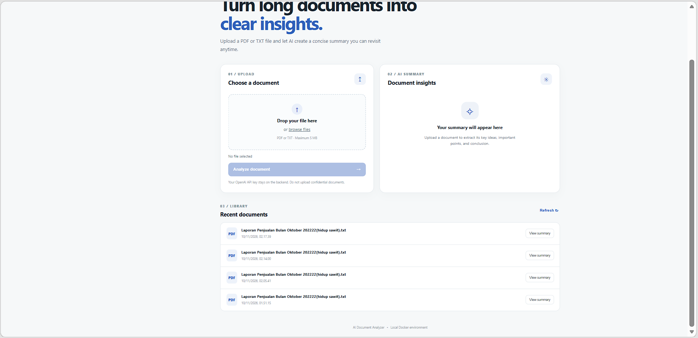

# AI Document Analyzer

**An AI-powered document analysis web application built with FastAPI, Google Gemini AI, PostgreSQL, and Docker Compose.**

AI Document Analyzer is a web-based application designed to simplify document reading and information extraction. Users can upload PDF and TXT files, extract readable text, generate AI-powered summaries in Indonesian, and access previously analyzed documents.

The project is developed as part of the Cloud Services course at BINUS University.

---

## 1. Project Overview

AI Document Analyzer provides a simple document processing workflow by combining text extraction, artificial intelligence, and persistent database storage.

Instead of manually reading lengthy documents, users can upload a document and receive an AI-generated summary containing:

- Document summary
- Key points
- Main conclusions

The application uses Google Gemini to generate summaries and PostgreSQL to store document information and analysis results.

## 2. Features

### Document Management
- Upload PDF and TXT documents.
- Validate supported file formats.
- Maximum upload size of 5 MB.
- Extract readable text from uploaded documents.
- View previously uploaded documents.
- Access saved document summaries.

### AI-Powered Analysis
- Generate summaries using Google Gemini AI.
- Produce summaries in Indonesian.
- Organize results into summary, key points, and conclusion sections.
- Limit input text to 30,000 characters for AI processing.

### System Features
- REST API powered by FastAPI.
- PostgreSQL database integration.
- Persistent database storage using Docker volumes.
- Health check endpoint.
- Docker Compose multi-container deployment.
- Nginx reverse proxy for frontend-to-backend communication.

## 3. Technology Stack

| Component | Technology |
|---|---|
| Frontend | HTML, CSS, JavaScript |
| Web Server | Nginx |
| Backend | Python 3.12, FastAPI |
| AI Integration | Google Gemini API |
| PDF Processing | PyMuPDF |
| Database | PostgreSQL 16 |
| ORM | SQLAlchemy |
| Containerization | Docker |
| Orchestration | Docker Compose |

## 4. System Architecture

The application follows a multi-tier architecture consisting of three main components.

### Architecture Components

**1. Frontend Layer**
- Provides the user interface.
- Handles document uploads.
- Displays AI-generated summaries.
- Displays document history.

**2. Backend Layer**
- Receives requests from the frontend.
- Validates uploaded documents.
- Extracts text using PyMuPDF.
- Sends document content to Google Gemini.
- Stores document information and summaries in PostgreSQL.

**3. Database Layer**
- Stores document filenames.
- Stores extracted text.
- Stores generated summaries.
- Stores document timestamps.

### Application Architecture

```text
              USER
                |
                v
       FRONTEND (HTML/CSS/JS)
                |
                v
          NGINX SERVER
       (Reverse Proxy)
                |
                v
        FASTAPI BACKEND
                |
        +-------+-------+
        |               |
        v               v
   PyMuPDF         Google Gemini
 Text Extraction   AI Summarization
        |               |
        +-------+-------+
                |
                v
          POSTGRESQL
                |
                v
       DOCUMENT HISTORY
```

### Docker Architecture

The application runs using three main Docker services:

| Service | Responsibility |
|---|---|
| Frontend | Serves the web application through Nginx |
| API | Handles document processing and AI integration |
| Database | Stores document data using PostgreSQL |

Google Gemini is an external API service accessed by the backend over HTTPS. It does not run inside a local Docker container.

## 5. Project Structure

The main project structure is organized as follows:

```text
ai-document-analyzer-V2/
│
├── backend/
│   ├── app/
│   │   ├── __init__.py
│   │   ├── main.py
│   │   ├── config.py
│   │   ├── database.py
│   │   ├── models.py
│   │   ├── schemas.py
│   │   └── services.py
│   │
│   ├── Dockerfile
│   └── requirements.txt
│
├── frontend/
│   ├── index.html
│   ├── style.css
│   ├── script.js
│   ├── Dockerfile
│   └── nginx.conf
│
├── docker-compose.yml
├── .env
├── .env.example
├── .gitignore
└── README.md
```

*Note: This structure is a reference. Adjust filenames and folders if the actual repository differs.*

## 6. Requirements

Before running the application, make sure the following tools are installed:

- Docker Desktop
- Docker Compose
- Git (optional, for repository management)
- Google Gemini API key

## 7. Installation and Setup

### Step 1. Clone the Repository

```bash
git clone https://github.com/daffaa1986/ai-document-analyzer.git
cd ai-document-analyzer
```

### Step 2. Create Environment Configuration

On Windows PowerShell:

```powershell
Copy-Item .env.example .env
```

On Linux or macOS:

```bash
cp .env.example .env
```

### Step 3. Configure Environment Variables

Open the `.env` file and configure the required variables.

Example:

```env
API_PORT=8001
FRONTEND_PORT=8081

GEMINI_API_KEY=your_gemini_api_key
GEMINI_MODEL=gemini-3.8-flash

POSTGRES_DB=documents
POSTGRES_USER=analyzer
POSTGRES_PASSWORD=your_database_password
```

Replace the example values with your own credentials.

**Important:** Never upload your actual `.env` file, API key, or database password to GitHub.

### Step 4. Build and Start the Application

Run the following command from the project root directory:

```bash
docker compose up -d --build
```

### Step 5. Check Container Status

```bash
docker compose ps
```

Make sure the frontend, API, and database containers are running and healthy.

### Step 6. Access the Application

| Service | URL |
|---|---|
| Frontend | http://localhost:8081 |
| Backend API | http://localhost:8001 |
| FastAPI Swagger UI | http://localhost:8001/docs |
| Health Check | http://localhost:8001/health |

## 8. API Documentation

The backend provides REST API endpoints through FastAPI.

### Available Endpoints

| Method | Endpoint | Description |
|---|---|---|
| GET | `/health` | Check API and database health |
| GET | `/documents` | Retrieve document history |
| GET | `/documents/{document_id}` | Retrieve a specific document |
| POST | `/documents/upload` | Upload and analyze a document |

### Health Check

Request:

```http
GET /health
```

Example response:

```json
{
  "status": "healthy",
  "database": "connected"
}
```

### Retrieve Documents

Request:

```http
GET /documents
```

Returns a list of previously stored documents.

### Upload Document

Request:

```http
POST /documents/upload
Content-Type: multipart/form-data
```

The endpoint accepts PDF and TXT files.

A successful upload returns HTTP status `201 Created` with the saved document information.

For interactive API testing, visit:

http://localhost:8001/docs

## 9. Docker Configuration

Docker Compose manages the application's services and infrastructure.

### Frontend Container
- Runs the Nginx web server.
- Serves HTML, CSS, and JavaScript files.
- Proxies API requests to the FastAPI backend.

### Backend Container
- Runs the FastAPI application.
- Processes uploaded documents.
- Integrates with Google Gemini.
- Communicates with PostgreSQL.

### Database Container
- Runs PostgreSQL 16.
- Stores document metadata and analysis results.
- Uses persistent storage through a Docker volume.

### Docker Compose Capabilities

The project uses Docker Compose to configure:

- Multiple application services.
- Container networking.
- Environment variables.
- Database persistence.
- Health checks.
- Service startup dependencies.

The exact service, network, volume, and health-check configurations are defined in `docker-compose.yml`.

## 10. Database Persistence

PostgreSQL uses a named Docker volume to preserve application data.

To verify persistence:

**Step 1.** Upload a sample document.

**Step 2.** Confirm that the document appears in Recent Documents.

**Step 3.** Stop the application:

```bash
docker compose down
```

**Step 4.** Start the application again:

```bash
docker compose up -d
```

**Step 5.** Refresh the frontend and verify that the previously saved document remains available.

**Important:** Avoid using `docker compose down -v` during persistence testing because the `-v` option removes declared named volumes and can delete database data.

## 11. Application Screenshots

Add screenshots of the actual application in this section.

Suggested screenshots:

1. Main dashboard and document upload interface.
2. Uploaded document and AI-generated summary.
3. Recent Documents library.
4. FastAPI Swagger UI.
5. Docker Compose container status.

Example:

```text
docs/
├── dashboard.png
├── ai-summary.png
├── document-library.png
├── api-documentation.png
└── docker-containers.png
```

## 12. Limitations

The current Minimum Viable Product (MVP) has the following limitations:

- Supports PDF and TXT documents only.
- Maximum upload size is 5 MB.
- Scanned or image-only PDFs are not supported.
- OCR functionality is not included.
- AI summarization requires a valid Google Gemini API key.
- AI input is limited to the first 30,000 characters.
- User authentication is not implemented.
- Multi-user access management is not included.

## 13. Future Improvements

Potential improvements for future development include:

- OCR support for scanned PDF documents.
- Support for additional document formats.
- Background processing for longer documents.
- Improved AI error handling and response management.
- Document search and filtering.
- User authentication and access control.
- Improved summary formatting and export functionality.

## 14. Security and Data Handling

Security considerations for this project include:

- Do not commit `.env` files or API credentials.
- Keep `.env.example` limited to placeholder values.
- Do not expose the Gemini API key in frontend JavaScript.
- Use sample documents for public demonstrations.
- Avoid uploading confidential or personal documents.
- Keep database credentials private.

## 15. AI Usage Declaration

This project was developed with partial AI assistance.

The actual AI usage declaration must be reviewed and completed by the student according to the course requirements.

**AI Tool Used:** ChatGPT

**Areas of Assistance:**
- Project planning and architecture suggestions.
- Initial code scaffolding and implementation guidance.
- Debugging and troubleshooting assistance.
- Documentation structure and README preparation.

**Student Contribution:**
- Reviewing and understanding the project implementation.
- Configuring the local development environment.
- Running Docker containers and application tests.
- Making implementation decisions and modifications.
- Reviewing and validating generated code.

**Example Prompt:**

"Help me develop a document analysis web application using HTML, CSS, JavaScript, FastAPI, PostgreSQL, Google Gemini API, and Docker Compose."

The student is responsible for accurately documenting AI assistance, verifying the implementation, and complying with the maximum 50% AI usage requirement.

## 16. Development Workflow

Suggested development stages:

1. Project initialization and folder structure.
2. FastAPI backend development.
3. PostgreSQL database integration.
4. PDF and TXT text extraction.
5. Google Gemini API integration.
6. Frontend development.
7. Dockerfile and Docker Compose configuration.
8. Integration testing and debugging.
9. Documentation and deployment preparation.

## 17. References

- Google Gemini API Documentation: https://ai.google.dev/gemini-api/docs
- FastAPI Documentation: https://fastapi.tiangolo.com/
- Docker Documentation: https://docs.docker.com/
- Docker Compose Documentation: https://docs.docker.com/compose/
- PostgreSQL Documentation: https://www.postgresql.org/docs/
- PyMuPDF Documentation: https://pymupdf.readthedocs.io/
- SQLAlchemy Documentation: https://docs.sqlalchemy.org/

---

**Project:** AI Document Analyzer  
**Course:** Cloud Services  
**University:** BINUS University  
**Project Type:** Academic Project  
**Year:** 2026


## Application Screenshots

### 1. Main Dashboard

The main dashboard integrates document upload, AI summary, and document library in a single page.



### 2. AI Summary Result

The AI summary result displays the document analysis generated by Google Gemini.


